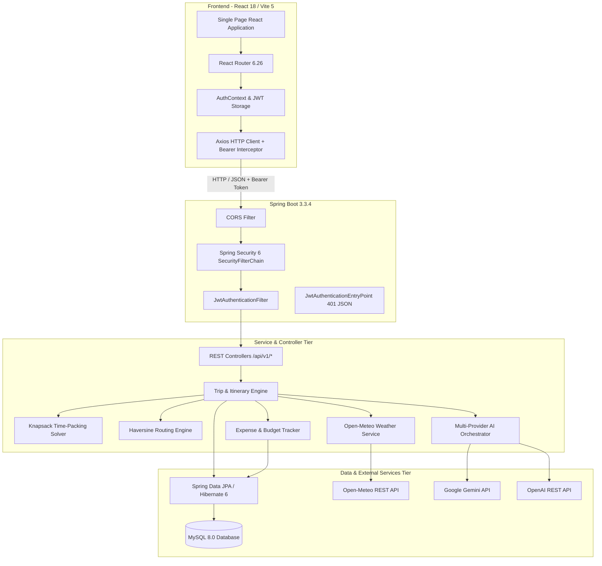
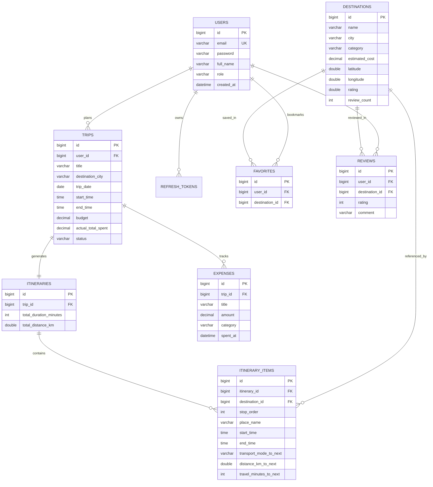

# Day Trip AI: Complete College Project Defense & Viva Preparation Guide

**Project Title**: Day Trip AI — Autonomous One-Day Travel & Itinerary Platform  
**Academic Level**: Final Year B.Tech / B.E. / M.C.A. Full-Stack Capstone Project  
**Author / Candidate**: Engineering Candidate  
**Tech Stack**: Java 21, Spring Boot 3.3.4, Spring Security 6, JJWT 0.12.6, Spring Data JPA / Hibernate 6, MySQL 8.0, React 18, Vite 5, Axios, Lucide React, Open-Meteo REST API, Google Gemini & OpenAI LLMs.

---

## Table of Contents
1. [Executive Project Summary](#1-executive-project-summary)
2. [High-Level System Architecture](#2-high-level-system-architecture)
3. [Software Engineering Design Patterns](#3-software-engineering-design-patterns)
4. [Relational Database Schema & ER Model](#4-relational-database-schema--er-model)
5. [Algorithmic Core: Knapsack Heuristic & Haversine Routing](#5-algorithmic-core)
6. [Security & Authentication Architecture](#6-security--authentication-architecture)
7. [External API Integrations & Fallback Resilience](#7-external-api-integrations)
8. [Comprehensive Viva Examination Q&A (25 Core Questions)](#8-comprehensive-viva-examination-qa)
9. [Examiner Live Demonstration Script](#9-examiner-live-demonstration-script)

---

## 1. Executive Project Summary

### 1.1 Problem Statement
One-day travelers and spontaneous tourists face severe decision fatigue and logistical bottlenecks:
1. **Time-Budget Fragmentation**: Standard trip planners optimize for multi-day trips with hotel bookings, failing to address tight 8-to-12-hour day constraints.
2. **Transit Detour Underestimation**: Travel times between intra-city spots are often miscalculated without factoring in urban road curvature and multi-modal transit velocities.
3. **Weather Mismatch**: Outdoor visits frequently get disrupted by unexpected rain or temperature spikes because itineraries lack real-time meteorological forecasts.
4. **Budget Leakage**: On-the-spot expenses (transit fares, entry tickets, dining) deviate significantly from initial estimates without real-time tracking.

### 1.2 The Day Trip AI Solution
Day Trip AI is an enterprise-grade full-stack platform that delivers:
- **Autonomous Itinerary Synthesis**: An $O(N)$ Knapsack time-packing heuristic that maximizes attraction ratings and popularity while enforcing strict time and financial budget limits.
- **Multi-Modal Geospatial Routing**: Geodesic distance calculation via the Haversine formula with a $1.30\times$ road curvature factor, transit speed modeling (driving 35 km/h, transit 24 km/h, walking 4.5 km/h), and realistic local fare matrices.
- **Meteorological Intelligence**: Live integration with the Open-Meteo REST service delivering hourly temperatures, precipitation probabilities, and AI packing advice.
- **Multi-Provider AI Studio**: Dynamic prompt orchestration with Google Gemini 1.5 Flash, OpenAI GPT-4o Mini, and deterministic rule-engine fallback.
- **Stateless JWT Security & Refresh Rotation**: HMAC-SHA256 access tokens and 7-day single-use UUID refresh token rotation.

---

## 2. High-Level System Architecture

---

## 3. Software Engineering Design Patterns

| Pattern | Where Applied | Purpose / Advantage |
|---|---|---|
| **Repository Pattern** | `DestinationRepository`, `TripRepository`, etc. | Decouples domain logic from SQL persistence; leverages Spring Data JPA dynamic queries. |
| **Service-DAO Pattern** | `TripService` $\rightarrow$ `TripServiceImpl` | Encapsulates business transactions and domain rules away from web controllers. |
| **Data Transfer Object (DTO)** | `TripCreateRequest`, `ItineraryResponse`, etc. | Prevents over-posting and entity leakage; decouples database schema from API contracts. |
| **Strategy Pattern** | `AiItineraryService` (Gemini, OpenAI, Fallback) | Allows swapping between AI LLM providers or offline rule engine at runtime without code alterations. |
| **Interceptor / Filter Pattern** | `JwtAuthenticationFilter`, Axios Bearer Interceptor | Centrally authenticates HTTP requests and injects `SecurityContext` without cluttering business methods. |
| **Template Method Pattern** | `BaseAuditableEntity` | Provides centralized `@CreatedDate` and `@LastModifiedDate` timestamp tracking for all entities. |
| **Centralized Exception Handler** | `GlobalExceptionHandler` (`@RestControllerAdvice`) | Formats all runtime exceptions, validation failures, and 401s into uniform `ApiResponse<T>` JSON envelopes. |

---

## 4. Relational Database Schema & ER Model

---

## 5. Algorithmic Core

### 5.1 The Knapsack Time-Packing Heuristic
One-day trip scheduling is mathematically an instance of the **0/1 Knapsack Problem** with temporal sequencing constraints (an NP-hard combinatorial optimization problem).

#### Mathematical Formulation:
- **Total Capacity $T$**: The net available trip time between `startTime` and `endTime` (e.g., 9:00 AM to 8:00 PM = 660 minutes).
- **Candidate Attractions**: Set of $N$ destinations $\{d_1, d_2, \dots, d_N\}$ in the target city.
- **Priority Scoring Function**:
  $$P(d_i) = w_r \cdot \text{rating}_i + w_p \cdot \mathbb{I}(\text{popular}_i) - w_c \cdot \left(\frac{\text{cost}_i}{\text{maxCost}}\right)$$
  *(where $w_r = 1.0$, $w_p = 0.5$, and $w_c = 0.2$)*.
- **Constraint Enforcement**:
  $$\sum_{i=1}^{k} \left(t_{\text{visit}}(d_i) + t_{\text{transit}}(d_i, d_{i+1}) + t_{\text{buffer}}\right) \le T$$
- **Meal Window Injection**: If the planned schedule spans the lunch window (12:30 PM – 2:00 PM), a 45-minute meal break is automatically synthesized at a popular local culinary stop.

### 5.2 Spherical Trigonometry (Haversine Formula) & Detour Coefficient
Direct Euclidean coordinates cannot be used on spherical Earth. The distance between points $(\phi_1, \lambda_1)$ and $(\phi_2, \lambda_2)$ in radians is calculated via:

$$\Delta \phi = \phi_2 - \phi_1, \quad \Delta \lambda = \lambda_2 - \lambda_1$$
$$a = \sin^2\left(\frac{\Delta \phi}{2}\right) + \cos(\phi_1)\cos(\phi_2)\sin^2\left(\frac{\Delta \lambda}{2}\right)$$
$$c = 2 \cdot \arctan2\left(\sqrt{a}, \sqrt{1-a}\right)$$
$$\text{GreatCircleDistance} = R \cdot c \quad (R = 6,371.0 \text{ km})$$

#### Road Detour Factor & Transit Modeling:
Because vehicles navigate road networks rather than straight great circles:
$$\text{EstimatedRoadDistance} = \text{GreatCircleDistance} \times 1.30$$

| Transit Mode | Assumed Speed | Local Fare Formula |
|---|---|---|
| **DRIVING / CAB** | $35 \text{ km/h}$ | $\text{Base ₹50} + (₹15 \times \text{km})$ |
| **TRANSIT / METRO / BUS** | $24 \text{ km/h}$ | $\text{Base ₹15} + (₹4 \times \text{km})$ |
| **WALKING** | $4.5 \text{ km/h}$ | Free (₹0) |

---

## 6. Security & Authentication Architecture

### 6.1 Stateless JWT Authentication Flow
1. **User Login**: Client submits credentials to `POST /api/v1/auth/login`.
2. **Authentication Verification**: `AuthenticationManager` verifies credentials against BCrypt-hashed passwords stored in MySQL.
3. **Token Generation**:
   - **Access Token**: Compact HMAC-SHA256 JWT signed with a 256-bit secret key, containing subject (`email`), claims (`userId`, `role`, `fullName`), valid for 24 hours.
   - **Refresh Token**: High-entropy UUID stored in the `refresh_tokens` table, valid for 7 days.
4. **Request Interception**: Client attaches `Authorization: Bearer <accessToken>` header on protected endpoints.
5. **Token Verification**: `JwtAuthenticationFilter` validates the signature and expiration, extracts user claims, and sets an authenticated `UsernamePasswordAuthenticationToken` in the Spring `SecurityContextHolder`.

### 6.2 Refresh Token Rotation Mechanism
To mitigate token theft, refresh tokens are **single-use only**:
- When the client calls `POST /api/v1/auth/refresh`, the presented token is verified and marked `revoked = true`.
- A brand-new refresh token and access token pair is issued and returned.

---

## 7. External API Integrations & Fallback Resilience

### 7.1 Open-Meteo REST Weather Service
- **Endpoint**: `https://api.open-meteo.com/v1/forecast`
- **Parameters**: `latitude`, `longitude`, `hourly=temperature_2m,precipitation_probability,weathercode,windspeed_10m`.
- **Circuit Breaker / Fallback**: If the external network request times out or returns non-200, the service falls back to a deterministic microclimate simulation based on geographic latitude and month of the year.

### 7.2 Multi-Provider AI Architecture
- **Google Gemini**: Uses `gemini-1.5-flash` endpoint with structured prompt engineering.
- **OpenAI**: Uses `gpt-4o-mini` endpoint with temperature $0.7$.
- **Offline Rule-Based Engine**: If external API keys are absent or network is disconnected, the system automatically uses the internal Knapsack heuristic solver without crashing.

---

## 8. Comprehensive Viva Examination Q&A (25 Core Questions)

### Q1: Why did you choose Spring Boot 3 instead of Node.js or Django?
**Answer**: Spring Boot 3 provides an enterprise-ready, strongly typed environment with Java 21 features (virtual threads, pattern matching). It provides robust transaction management (`@Transactional`), compile-time type safety, declarative ORM mapping with Hibernate 6, and a production-grade security framework (Spring Security 6) that is preferred in financial and large-scale travel platforms.

### Q2: What is the purpose of Spring Data JPA, and how does it prevent SQL injection?
**Answer**: Spring Data JPA abstracts JDBC operations and generates queries via Hibernate. It uses **parameterized queries / PreparedStatements** under the hood. When querying by parameters (e.g. `findByEmail(String email)`), user input is treated strictly as data literals and never concatenated into executable SQL strings, eliminating SQL injection vulnerabilities.

### Q3: Explain how your Knapsack Itinerary Heuristic works.
**Answer**: It treats one-day scheduling as a bounded knapsack problem where time is the limiting capacity. Candidates are ranked by a composite utility score taking into account rating, popularity flag, and cost penalty. Attractions are packed sequentially while calculating transit hops and visit durations until the time budget is exhausted, with a dedicated lunch stop automatically inserted during the noon window.

### Q4: Why use the Haversine formula instead of Euclidean distance $(x_2-x_1)^2 + (y_2-y_1)^2$?
**Answer**: Earth is an oblate spheroid, not a flat 2D plane. Euclidean calculations ignore Earth's curvature and introduce extreme distortions as latitude changes. The Haversine formula computes great-circle geodesic distance using spherical trigonometry. We multiply this by a $1.30\times$ detour factor to approximate actual street grid navigation.

### Q5: How is stateless session management achieved with JWT?
**Answer**: In traditional sessions, the server stores session IDs in memory or Redis (`HttpSession`), which consumes memory and limits horizontal scaling. In stateless JWT, the user's identity and authorities are encoded and cryptographically signed inside the token itself. The server simply verifies the HMAC-SHA256 signature on incoming requests without database lookups.

### Q6: What happens if an access token is compromised?
**Answer**: Access tokens have a limited lifetime (24 hours). Furthermore, we implemented **Refresh Token Rotation**: refresh tokens are stored in the database with revocation flags. If a refresh token is revoked or reused, the session is terminated immediately.

### Q7: Explain the significance of `@RestControllerAdvice` in your backend.
**Answer**: `@RestControllerAdvice` provides centralized exception handling across all controllers. Instead of wrapping every method in repetitive `try-catch` blocks, exceptions (such as `ResourceNotFoundException`, `MethodArgumentNotValidException`, and `AccessDeniedException`) are caught globally and translated into clean, standardized `ApiResponse<T>` JSON responses with appropriate HTTP status codes (400, 401, 403, 404, 500).

### Q8: What is CORS, and how is it configured in your application?
**Answer**: Cross-Origin Resource Sharing (CORS) is a browser security mechanism that blocks web pages from making requests to a different domain or port than the one that served the page. Because our React frontend runs on `http://localhost:5173` and the backend on `http://localhost:8080`, we configured a `CorsConfigurationSource` in Spring Security allowing `GET`, `POST`, `PUT`, `DELETE`, `PATCH`, and `OPTIONS` with appropriate headers.

### Q9: Why use React Router 6 instead of multi-page HTML?
**Answer**: React Router 6 enables a **Single Page Application (SPA)** architecture. Navigation between Home, Destinations, Trips, and Favorites happens client-side without full-page browser reloads, providing snappy UI transitions, persistent client state, and reduced server bandwidth consumption.

### Q10: How do you prevent over-budget situations during trip planning?
**Answer**: The `ExpenseService` recalculates the cumulative actual spend whenever an expense is created, updated, or deleted, and dynamically updates the `actualTotalSpent` on the parent `Trip` entity. The frontend displays real-time progress meters that turn red with warning badges whenever expenses exceed the specified budget limit.

### Q11: What is the N+1 select problem in JPA, and how did you prevent it?
**Answer**: The N+1 problem occurs when fetching an entity with lazy relationships causes Hibernate to execute 1 query for the parent entity and then N separate queries for each associated child. We mitigated this by using **DTO projections**, targeted join fetch queries (`JOIN FETCH`), and ensuring non-collection entity relationships are fetched thoughtfully.

### Q12: How does the AI fallback mechanism work?
**Answer**: The `AiItineraryServiceImpl` attempts to generate an itinerary via external LLM APIs (Gemini or OpenAI). If the API key is not configured, the network is unreachable, or the response does not parse into valid JSON, the service seamlessly falls back to our deterministic, local Knapsack rule engine. This ensures the user never experiences a 500 internal server error.

### Q13: Why did you separate `Trip` and `Itinerary` into two entities?
**Answer**: This follows the **Single Responsibility Principle**. `Trip` represents the user's intent, constraints, and metadata (title, dates, budget, starting point, status). `Itinerary` represents the concrete execution plan (chronologically ordered items, transit hops, arrival/departure timestamps). A trip can exist in draft status before an itinerary is generated, and itineraries can be regenerated without losing the parent trip's configuration.

### Q14: Explain the role of the `@Transactional` annotation.
**Answer**: `@Transactional` ensures that a series of database operations execute within an atomic transaction. If any runtime exception occurs during execution (e.g. while inserting itinerary items), the entire transaction is rolled back, preventing corrupted or half-written database states.

### Q15: What HTTP status codes are used across your REST APIs?
- `200 OK`: Successful retrieval or update.
- `201 Created`: Successful resource creation (trip, stop, review).
- `400 Bad Request`: Validation failure or malformed payload.
- `401 Unauthorized`: Missing or invalid JWT bearer token.
- `403 Forbidden`: Authenticated user lacks required role (e.g., non-admin attempting admin endpoint).
- `404 Not Found`: Resource ID does not exist in the database.
- `500 Internal Server Error`: Unhandled server exception.

### Q16: How do you hash user passwords?
**Answer**: We use Spring Security's `BCryptPasswordEncoder` with a work factor (strength) of 10. BCrypt automatically incorporates a randomly generated cryptographic salt, protecting against rainbow table attacks, and is intentionally CPU-intensive to mitigate brute-force attacks.

### Q17: What are the benefits of using Vite over Create React App (CRA)?
**Answer**: Vite uses native ES modules (`ESM`) during development and esbuild for pre-bundling, resulting in near-instantaneous dev server startup and hot module replacement (HMR). For production, it uses Rollup to create highly optimized, treeshaken static bundles.

### Q18: What is the difference between `Authentication` and `Authorization` in Spring Security?
**Answer**: 
- **Authentication** verifies *who you are* (e.g., validating email and password to prove identity via JWT).
- **Authorization** determines *what you are allowed to do* (e.g., verifying if the authenticated user possesses `ROLE_ADMIN` before allowing destination creation).

### Q19: Explain the purpose of `BaseAuditableEntity`.
**Answer**: It is an abstract `@MappedSuperclass` with `@CreatedDate` and `@LastModifiedDate` annotations. By enabling Spring Data JPA auditing, Hibernate automatically populates creation and update timestamps on all inheriting entities (`User`, `Destination`, `Trip`, `Expense`), ensuring audit trail integrity.

### Q20: How are reviews linked to destination ratings?
**Answer**: In `ReviewServiceImpl`, whenever a user submits a review, the service recalculates the cumulative average rating and increments the `reviewCount` for that destination within a transactional boundary, guaranteeing that the destination card always displays accurate aggregate ratings.

### Q21: What is the role of `DataInitializer.java`?
**Answer**: It implements `CommandLineRunner` to seed the database with initial demonstration data on application startup if the tables are empty. It seeds an admin user, a traveler user, and 15 curated destinations across categories and cities (Mumbai, Pune, Hyderabad, Lonavala) so the platform is immediately operational out-of-the-box.

### Q22: Why did you implement dual tokens (Access + Refresh)?
**Answer**: Short-lived access tokens limit the window of vulnerability if a token is intercepted. The refresh token allows the client to silently obtain new access tokens without requiring the user to re-enter their password frequently, striking the ideal balance between security and user experience.

### Q23: How does your frontend manage authentication state?
**Answer**: Through `AuthContext.jsx` using React's Context API. It stores tokens in `localStorage`, attaches the Bearer token to all outgoing Axios requests via an interceptor, and provides `currentUser`, `login`, `register`, and `logout` hooks to any component in the tree.

### Q24: What database indexes were created, and why?
**Answer**: Unique indexes on `users(email)`, foreign key indexes on `trips(user_id)`, `itineraries(trip_id)`, `expenses(trip_id)`, and composite indexes on `destinations(city, category)` to accelerate search, filtering, and join queries.

### Q25: How would you scale this system for 100,000 active users?
**Answer**:
1. **Caching**: Introduce Redis to cache destination catalogs, category lists, and weather forecasts.
2. **Stateless Clustering**: Run multiple Spring Boot backend instances behind an Nginx or AWS ALB load balancer.
3. **Database Read Replicas**: Separate MySQL read and write operations using read replicas.
4. **Asynchronous Tasks**: Offload AI prompt generation to message queues (RabbitMQ / Kafka).

---

## 9. Examiner Live Demonstration Script

Follow this step-by-step procedure during your viva presentation:

1. **Architecture & Health Check**:
   - Open browser to `http://localhost:8080/api/v1/health` $\rightarrow$ Show JSON response: `"status": "UP"`.
   - Open Swagger UI at `http://localhost:8080/swagger-ui/index.html` $\rightarrow$ Point out all 10 controller modules and documented REST endpoints.

2. **Frontend Walkthrough (`http://localhost:5173`)**:
   - **Home Page**: Show hero banner, metrics ribbon, and top-rated destination cards.
   - **Quick Search**: Enter "Mumbai" $\rightarrow$ Demonstrates instant routing to `DestinationsPage` filtered by city.

3. **Authentication Demonstration**:
   - Click **Sign In** in the top navigation bar.
   - Click the **Demo Quick Sign-In** button for **✈️ Alex Traveler** (`traveler@daytripai.com`).
   - Show user avatar appearing in the navbar with role `✈️ Traveler`.

4. **Geospatial Route & Transit**:
   - Click the **Route & Transit** button in the navbar.
   - Point out origin and target coordinates. Select **Driving** vs **Transit**.
   - Show Haversine geodesic distance, estimated duration with $1.30\times$ detour factor, and estimated local cab fare.

5. **Live Meteorological Forecast**:
   - On any destination card, click **Weather Forecast**.
   - Show live Open-Meteo temperature, condition, precipitation probability, humidity, and AI packing advice.

6. **Trip Planning & Itinerary Synthesis**:
   - Navigate to **My Trips & Planner**.
   - Click **Plan New Day Trip**. Select destination city, date, and check candidate spots.
   - Click **View Itinerary & Timeline**:
     - Point out the chronologically ordered stops.
     - Show the transit hops between stops with estimated travel times and modes.
     - Demonstrate the stop reordering arrows ($\uparrow$ / $\downarrow$).

7. **Real-Time Expense Tracking**:
   - On the trip card, click **Expense Log & Analytics**.
   - Add a test expense (e.g., "Lunch & Drinks", ₹450, category `FOOD`).
   - Show instant budget update and category breakdown percentage.

8. **AI Travel Studio**:
   - Click **AI Travel Studio** on the trip card.
   - Select provider (**Gemini 1.5 Flash**, **OpenAI GPT-4o Mini**, or **Deterministic Fallback**).
   - Click **Generate AI Plan** $\rightarrow$ Show synthesized itinerary narrative and timeline.

9. **Terminal Verification**:
   - Show running backend terminal with passing test suite (`38 tests run, 0 failures, 0 errors`).
   - Show `target/day-trip-ai-backend-1.0.0.jar` production package.
